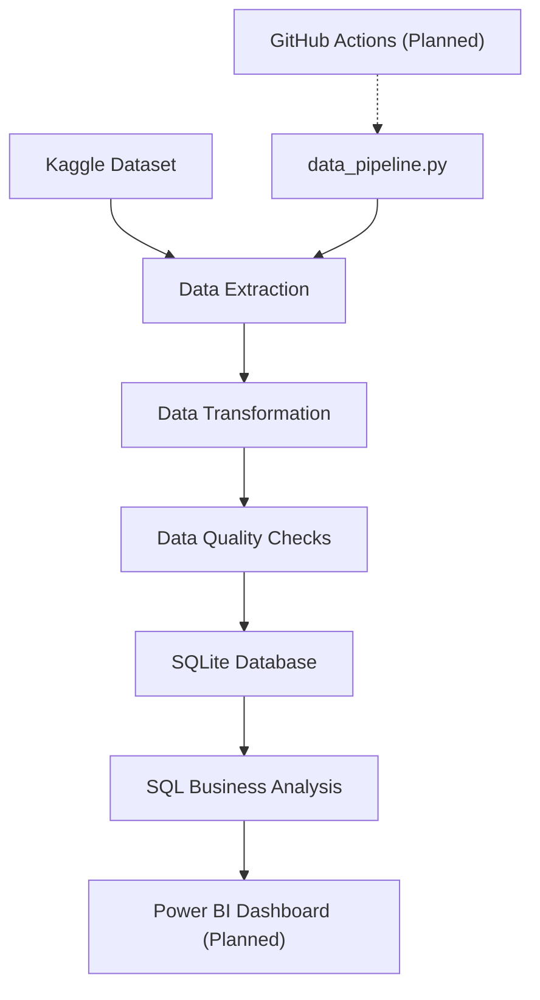

# Automated E-Commerce Sales & Product Analytics Pipeline

An end-to-end data analytics automation project built using **Python, Pandas, SQLite and SQL**. The project automates the extraction, transformation, validation and storage of historical e-commerce data, creating a structured foundation for business intelligence reporting.

It demonstrates practical skills in ETL development, data quality validation, relational database design, SQL analysis and pipeline orchestration.

## Project Overview

The objective is to analyse historical e-commerce transactions and generate insights into sales performance and product category performance.

### Key Business Questions

- How much revenue does the business generate?
- How do sales and order volumes change over time?
- What is the average order value?
- Which product categories generate the highest revenue?
- How many items are sold, and what are the associated freight charges?

## Technology Stack

| Technology | Purpose |
|---|---|
| Python | ETL development and pipeline orchestration |
| Pandas | Data cleaning and transformation |
| Kaggle API | Automated dataset extraction |
| SQLite | Relational database storage |
| SQL | Data validation and business analysis |
| Git & GitHub | Version control and project management |
| GitHub Actions | Workflow automation (planned) |
| Power BI | Business intelligence reporting (planned) |

## Pipeline Architecture

The pipeline executes four main stages in sequence. GitHub Actions will provide automated execution once configured.



## Data Source

**Olist Brazilian E-Commerce Public Dataset**

Source: [Kaggle – Brazilian E-Commerce Public Dataset by Olist](https://www.kaggle.com/datasets/olistbr/brazilian-ecommerce)

The dataset contains historical Brazilian e-commerce transactions from 2016 to 2018. It does not represent live transactions.

### Source Files Used

| Source File | Purpose |
|---|---|
| `olist_orders_dataset.csv` | Order identifiers, statuses and purchase timestamps |
| `olist_order_items_dataset.csv` | Product items, prices and freight values |
| `olist_products_dataset.csv` | Product identifiers and category names |
| `product_category_name_translation.csv` | Portuguese-to-English category translation |

## ETL Process

### 1. Extract

- Connect to the Kaggle dataset using the Kaggle API.
- Download and extract the source files programmatically.
- Verify that all required source files are available.
- Skip unnecessary downloads when the required local files already exist.

### 2. Transform

- Select the columns required for sales and product analysis.
- Convert purchase timestamps into datetime values.
- Convert price and freight columns into numeric data types.
- Translate product categories into English.
- Assign `Unknown` to missing category translations.
- Preserve original source files and save transformed data separately.

### 3. Load

Load the transformed datasets into SQLite using a relational data model.

| Database Table | Description |
|---|---|
| `DimOrders` | Order details, status and purchase timestamp |
| `DimProducts` | Product identifiers and English category names |
| `FactOrderItems` | Order items, product references, prices and freight values |

The fact table connects to both dimension tables through `order_id` and `product_id`.

### 4. Validate

The pipeline performs data quality and database integrity checks, including:

- Missing or invalid timestamps.
- Missing or invalid prices and freight values.
- Duplicate dimension keys and missing key fields.
- Unmatched order and product references.
- SQLite foreign-key integrity checks.

## SQL Analysis & Business Findings

The SQLite database is queried to calculate sales performance and product category metrics.

### Key Performance Indicators

| KPI | Result |
|---|---:|
| Delivered orders | 96,478 |
| Items sold | 110,197 |
| Item revenue | R$13,221,498.11 |
| Freight value | R$2,198,275.64 |
| Average order value (AOV) | R$137.04 |

**Calculation definitions:**

- Item revenue = Sum of order item prices.
- Freight value = Sum of freight charges.
- Items sold = Number of order-item records.
- AOV = Item revenue divided by distinct delivered orders.

Figures are based on delivered orders. Item revenue excludes freight. All monetary amounts are in Brazilian reais (BRL).

### Initial Business Insights

1. **Top-performing category:** Health & Beauty generated approximately R$1.23 million in item revenue.
2. **Second-highest category:** Watches & Gifts generated approximately R$1.17 million.
3. **Third-highest category:** Bed, Bath & Table generated approximately R$1.02 million.
4. **Monthly peak:** November 2017 recorded the highest delivered order volume, with 7,289 orders and approximately R$988,000 in item revenue.

These findings provide a foundation for further sales and product performance analysis.

## Project Structure

```text
ecommerce-automation/
│
├── data/
│   ├── raw/                       # Downloaded source CSV files (not committed)
│   └── processed/                 # Cleaned CSV files and SQLite database (not committed)
│
├── scripts/
│   ├── extract_data.py            # Kaggle data extraction
│   ├── transform_data.py          # Data cleaning and transformation
│   ├── load_database.py           # SQLite database loading
│   └── validate_database.py       # SQL validation and analysis
│
├── .github/
│   └── workflows/                 # GitHub Actions workflows (planned)
│
├── data_pipeline.py               # Main pipeline orchestrator
├── requirements.txt               # Python dependencies
├── .gitignore                     # Excludes data, credentials and environments
└── README.md                      # Project documentation
```

## Running the Pipeline Locally

### Prerequisites

- Python
- Git
- Kaggle account and API access

### 1. Clone the repository

```bash
git clone https://github.com/omermohammed-hub/ecommerce-automation.git
cd ecommerce-automation
```

### 2. Create and activate a virtual environment

**Windows PowerShell:**

```powershell
python -m venv venv
.\venv\Scripts\Activate.ps1
```

**macOS/Linux:**

```bash
python -m venv venv
source venv/bin/activate
```

### 3. Install dependencies

```bash
pip install -r requirements.txt
```

### 4. Configure Kaggle authentication

Configure the Kaggle API credentials required by the Kaggle CLI on your local machine.

Never commit API tokens, credential files or private configuration to the repository.

### 5. Execute the complete pipeline

```bash
python data_pipeline.py
```

The main script executes all four stages in sequence:

1. Extract source data.
2. Transform and validate datasets.
3. Load the data into SQLite.
4. Execute SQL validation and business analysis.

If a stage fails, the pipeline stops and reports the error.

## Project Progress

### Completed

- [x] Kaggle data extraction script.
- [x] Data transformation using Pandas.
- [x] Data quality validation.
- [x] SQLite database creation.
- [x] Relational data model design.
- [x] SQL business analysis.
- [x] End-to-end local pipeline orchestration.
- [x] Initial Git repository and project documentation.

### Planned

- [ ] GitHub Actions automation.
- [ ] Secure Kaggle authentication through GitHub Secrets.
- [ ] Scheduled and manual workflow execution.
- [ ] Power BI dashboard integration.
- [ ] Final project documentation and presentation.

## Dataset Attribution & Licence

The Olist dataset is distributed under the **Creative Commons Attribution-NonCommercial-ShareAlike 4.0 International (CC BY-NC-SA 4.0)** licence.

Refer to the [original Kaggle dataset](https://www.kaggle.com/datasets/olistbr/brazilian-ecommerce) for full attribution and licence conditions.

This project is developed for educational and portfolio demonstration purposes.